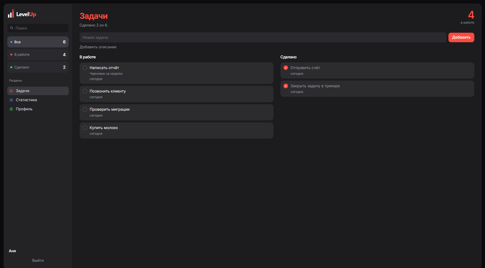
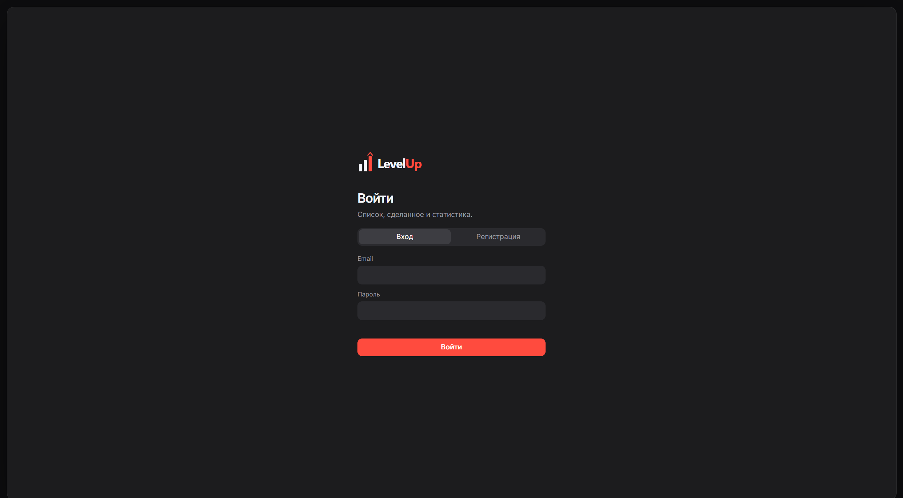

<p align="center">
  <picture>
    <source media="(prefers-color-scheme: dark)" srcset="assets/logo-dark.svg">
    
  </picture>
</p>

<h1 align="center">Список, в котором видно темп</h1>

<p align="center">
Свои задачи на одном экране.<br>
Отметил сделанное, и сразу видно, сколько закрыто и сколько это заняло.
</p>

<p align="center">
  <a href="https://github.com/cdlinkin/todoapp/actions/workflows/ci.yml"></a>
</p>

<p align="center">
  
</p>

Тёмный список. Слева поиск, три счётчика и разделы. Справа две колонки: что ещё в работе и что уже сделано. Заголовок и число открытых задач коралловые, галочка у сделанной задачи тоже. Три столбика в знаке коротко подрастают: это и есть level up.

## Как выглядит

<p align="center">
  
</p>

Вход и регистрация на том же экране. После входа открываются задачи, статистика и профиль. Поиск и фильтр остаются в адресе страницы, так что ссылку на «только сделанное» можно оставить себе. Узкий экран складывает колонку и список друг под друга. Клавиша `n` (или `т`) ставит курсор в поле новой задачи, если фокус не в поле ввода.

## Запуск

Нужен запущенный Docker Desktop: в трее кит должен быть зелёным. Пока движок не поднялся, `docker compose` отвечает, что не находит `dockerDesktopLinuxEngine`. Ещё нужны Go 1.25+ и `make`. Makefile написан под Windows: локальный запуск и очистка идут через `cmd` и PowerShell, остальное вызывает `docker compose` и `go`.

```bash
git clone https://github.com/cdlinkin/todoapp.git
cd todoapp
cp .env.example .env
```

В `.env` нужны пароль базы и секрет для токенов. Секрет не короче 32 байт, иначе приложение не стартует. Строку можно собрать так: `openssl rand -base64 32`.

```env
HTTP_ADDR=:5050
HTTP_SHUTDOWN_TIMEOUT=30s
ALLOWED_ORIGINS=http://localhost:5050,null

POSTGRES_USER=admin
POSTGRES_PASSWORD=change-me
POSTGRES_DB=todoapp
POSTGRES_TIMEOUT=10s
POSTGRES_PORT=9998

LOGGER_LEVEL=DEBUG

AUTH_JWT_SECRET=
AUTH_TOKEN_TTL=24h

REDIS_TIMEOUT=2s
REDIS_TTL=30s
```

`POSTGRES_HOST`, `REDIS_ADDR` и `LOGGER_FOLDER` в `.env` не пишутся. `make levelup-run` подставляет `localhost`, `localhost:6379` и `./out/logs`. В Docker те же значения стоят в `docker-compose.yaml`: база по имени `todoapp-postgres`, Redis по `todoapp-redis:6379`.

```bash
make env-up
make migrate-up
make levelup-run
```

`env-up` поднимает Postgres, Redis и проброс порта базы. Снаружи Postgres слушает `127.0.0.1:9998`, а не 5432, чтобы не спорить с Postgres на машине. Redis слушает `127.0.0.1:6379` и тома не имеет: после остановки кэш пустой. Если сразу после первого запуска миграция или приложение отвечает `connection refused`, контейнер ещё стартует, подождите пару секунд.

Приложение при старте делает Ping и к Postgres, и к Redis. Нет одного из них, процесс не поднимается.

Откройте http://localhost:5050/ и зарегистрируйтесь. Swagger: http://localhost:5050/swagger/index.html.

Полностью в Docker, вместо `make levelup-run`:

```bash
make levelup-deploy
```

`make env-down` останавливает Postgres и Redis. `make env-cleanup` останавливает их вместе с пробросом порта и удаляет `out/pgdata`.

Те же шаги есть в `Makefile`. Команда `make` без аргументов печатает список.

| | |
|---|---|
| `make env-up` | Postgres, Redis и проброс порта |
| `make env-down` | остановить Postgres и Redis |
| `make env-cleanup` | остановить окружение и удалить файлы базы |
| `make migrate-up` | накатить миграции |
| `make migrate-down` | откатить миграции |
| `make migrate-create seq=name` | новая миграция |
| `make levelup-run` | `go run ./cmd/levelup` |
| `make levelup-deploy` | собрать и запустить приложение в Docker |
| `make levelup-undeploy` | остановить контейнер приложения |
| `make test` | `go test` |
| `make vet` | `go vet` |
| `make build` | собрать пакеты |
| `make swagger-gen` | пересобрать Swagger |

### Переменные окружения

| | |
|---|---|
| `HTTP_ADDR` | адрес сервера, в примере `:5050` |
| `HTTP_SHUTDOWN_TIMEOUT` | сколько ждать уже начатые запросы при остановке |
| `ALLOWED_ORIGINS` | откуда браузеру можно ходить в API |
| `POSTGRES_USER`, `POSTGRES_PASSWORD`, `POSTGRES_DB` | база в контейнере |
| `POSTGRES_PORT` | порт снаружи, в примере `9998` |
| `POSTGRES_HOST` | только при запуске. Локально `make` ставит `localhost`, в compose это `todoapp-postgres` |
| `POSTGRES_TIMEOUT` | таймаут запросов к базе |
| `REDIS_ADDR` | локально `localhost:6379`, в compose `todoapp-redis:6379` |
| `REDIS_TIMEOUT` | таймаут клиента Redis |
| `REDIS_TTL` | сколько жить готовой статистике, в примере `30s` |
| `AUTH_JWT_SECRET` | обязателен, минимум 32 байта |
| `AUTH_TOKEN_TTL` | срок access-токена, в примере `24h` |
| `LOGGER_LEVEL` | уровень логов, в примере `DEBUG` |
| `LOGGER_FOLDER` | локально `./out/logs`, в контейнере `/app/out/logs` |

## Что умеет

Регистрация и вход. Пароль хранится как bcrypt-хеш, дальше каждый запрос идёт с JWT. Задачи видит только автор: создать, поправить, отметить сделанной, удалить.

- Статистика за период: сколько создано, сколько сделано, процент и среднее время. Повтор того же периода берётся из Redis.
- Поиск по названию и описанию среди уже загруженных задач, фильтры «все / в работе / сделано». Дальше по списку кнопка «Показать ещё», по 20 задач.
- Профиль: имя и телефон. Пустой телефон очищает поле. Email не меняется. Аккаунт, у которого ещё есть задачи, не удаляется: сервер ответит 409.
- В PATCH поле можно не передавать (останется как было), передать новое значение или передать `null`, чтобы очистить.
- Чужая задача выглядит как 404, её как будто нет. Чужой профиль отвечает 403. Неверный пароль и несуществующий email при входе дают один и тот же 401.
- Задачи и пользователи обновляются с проверкой `version`. Две правки одной записи не затирают друг друга: вторая получает 409.
- Swagger UI, чтобы потыкать API без Postman.
- Фронт это одна страница `public/index.html` и соседние стили со знаком. Их отдаёт тот же сервер.

## Как устроено

Go 1.25 и стандартный `net/http`. Роутер уже умеет методы и параметры в пути, отдельный фреймворк не понадобился. Postgres 18 через `pgx`, Redis 7 через `go-redis` v9.22 (клиент новее требует Go 1.26, поэтому версия зафиксирована). Миграции через `golang-migrate`, токены через `golang-jwt`, логи через `zap`, описание API через `swag`. Модуль называется `github.com/cdlinkin/LevelUp`.

```
cmd/levelup/                 сборка зависимостей и роуты
internal/
  core/                      логгер, пул, middleware, JWT, клиент Redis
  features/
    auth/                    регистрация, вход, текущий пользователь
    users/                   профиль
    tasks/                   задачи
    statistics/              четыре числа и кэш
    web/                     страница и файлы из public/
migrations/
public/                      страница, стили, знак
```

Внутри фичи одна раскладка: `transport/http` разбирает запрос, `service` проверяет правила, `repository/postgres` пишет SQL. Сервис знает о базе и о кэше только через интерфейс, и интерфейс объявлен там, где он используется. В тестах вместо Postgres и Redis стоят фейки.

У пользователя три структуры: DTO для JSON, доменная модель и модель строки. Хеш пароля в ответ уйти не может: в DTO такого поля нет. Ошибки помечаются маркерами вроде `ErrNotFound` и `ErrConflict` и пробрасываются через `%w`. В HTTP-статус они превращаются в одном месте.

### Путь одной статистики

`GET /api/v1/statistics` считает четыре числа по задачам пользователя. Сервис сначала проверяет период (`to` позже `from`), потом смотрит Redis. Ключ такой: `stats:<user_id>:<version>:<from>:<to>`. Даты те же, что в query, `YYYY-MM-DD` в UTC. Если `from` или `to` не передали, на этом месте стоит `all`.

Версия лежит отдельно, в `stats:ver:<user_id>`, и до первой правки равна 0. Создание, правка и удаление задачи увеличивают версию только этого автора и только после успешной записи. Чужие ключи не трогаются. Следующий запрос того же человека уже не находит старый ключ и считает заново из Postgres. Если сброс версии не записался, сама задача всё равно сохранена, а старый ответ доживёт не дольше `REDIS_TTL`.

Пустой период тоже записывается. Нули в JSON это попадание в кэш, а не повод читать базу снова. В кэше длительность лежит в наносекундах, чтобы ноль и «ещё не было» не смешались.

Если Redis отвалится уже на запросе, ошибка попадёт в лог, а статистика посчитается из Postgres. На старте так нельзя: Ping обязателен, как у пула базы.

## API

Подробно с примерами в Swagger. Всё лежит под `/api/v1`. Без токена открыты только регистрация и вход. Остальное ждёт заголовок `Authorization: Bearer <token>`.

| | | |
|---|---|---|
| POST | `/auth/register` | регистрация |
| POST | `/auth/login` | вход, в ответе `access_token` |
| GET | `/auth/me` | кто я |
| GET | `/tasks?limit=&offset=` | свои задачи |
| POST | `/tasks` | новая задача |
| GET | `/tasks/{id}` | одна задача |
| PATCH | `/tasks/{id}` | правка, в том числе `completed` |
| DELETE | `/tasks/{id}` | удалить свою |
| GET | `/statistics?from=&to=` | четыре числа, `to` в период не входит |
| GET | `/users/{id}` | профиль |
| PATCH | `/users/{id}` | имя и телефон |
| DELETE | `/users/{id}` | удалить аккаунт, если задач не осталось |

Даты статистики в формате `YYYY-MM-DD`. Телефон, если он есть, выглядит как `+79998887766`. Имя от 3 символов, пароль от 8 байт.

```bash
curl -X POST http://localhost:5050/api/v1/auth/register \
  -H "Content-Type: application/json" \
  -d '{"full_name":"Ivan Ivanov","email":"ivan@mail.ru","password":"secret123"}'

curl -X POST http://localhost:5050/api/v1/auth/login \
  -H "Content-Type: application/json" \
  -d '{"email":"ivan@mail.ru","password":"secret123"}'

curl http://localhost:5050/api/v1/tasks -H "Authorization: Bearer <token>"
```

## Тесты

```bash
make test
```

База и Redis для тестов не нужны. Покрыты доменная валидация и PATCH по принципу «всё или ничего», хеширование паролей, JWT (чужой секрет, просроченный токен, `alg: none`), auth-middleware, сервисы на фейках, в том числе запрет читать и менять чужое, кэш статистики и сброс версии, HTTP-хендлеры через `httptest`.

На каждый PR и пуш в `main` GitHub Actions прогоняет `gofmt`, `go vet`, `go test -race` и сборку Docker-образа.

Если поменялись swagger-аннотации:

```bash
make swagger-gen
```
